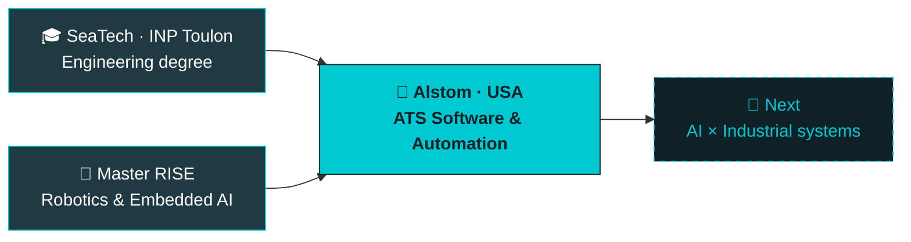

<!-- ═══════════════════════════════ HEADER ═══════════════════════════════ -->

  

  

  
  
  

<!-- ═══════════════════════════════ NOW ═══════════════════════════════ -->
## 🚆 Right now

**V.I.E Software & Automation Engineer @ [Alstom](https://www.alstom.com) — Pittsburgh, USA**
I build tools for **ATS (Automatic Train Supervision)** systems: automating engineering workflows, processing large configuration and log datasets, and bringing AI-assisted tooling into railway software projects.

> [!NOTE]
> **Where's my day-to-day code?** My professional work is covered by confidentiality and lives on a separate, company-managed GitHub account.
> This profile showcases my **personal AI, data and robotics projects**, which is why my public contribution graph doesn't reflect my full activity.

<!-- ═══════════════════════════════ JOURNEY ═══════════════════════════════ -->
## 🧭 Journey

<!-- ═══════════════════════════════ STACK ═══════════════════════════════ -->
## 🧰 Tech stack

  
   
  

  
  
  
  
  
  
  

<!-- ═══════════════════════════════ PROJECTS ═══════════════════════════════ -->
## 💼 Featured projects

<table>
  <tr>
    <td width="50%" valign="top">
      <h3>⚡ <a href="https://github.com/enzocherif/indian-electricity-price-forecasting">Electricity Price Forecasting</a></h3>
      Forecasts daily prices on the Indian power exchange from generation mix, historical prices and weather data. Built over a single weekend for an interview case study.
        
        
    </td>
    <td width="50%" valign="top">
      <h3>🔥 <a href="https://github.com/enzocherif/PyTorch-Fundamentals-DeepLearning.AI-">PyTorch Fundamentals</a></h3>
      Neural networks from scratch in PyTorch: tensors, activation functions, an MNIST image classifier and feature-engineered regression (DeepLearning.AI).
        
        
    </td>
  </tr>
  <tr>
    <td width="50%" valign="top">
      <h3>📩 <a href="https://github.com/enzocherif/Neural-Network-SMS-Text-Classifier">SMS Spam Classifier</a></h3>
      Bidirectional LSTM that separates spam from legitimate SMS messages, from text preprocessing to evaluation.
        
        
    </td>
    <td width="50%" valign="top">
      <h3>🦾 <a href="https://github.com/enzocherif/qtm_interface">Motion-Capture Robot Control</a></h3>
      Bridges a Qualisys motion-capture system with ROS to track and pilot a robot in real time, with a user interface and simulation scripts.
        
        
    </td>
  </tr>
</table>

<b>🗂️ More AI & data projects</b> <i>(click to expand)</i>

 

| Project | What it does | Stack |
|---|---|---|
| 📚 [Book Recommendation Engine](https://github.com/enzocherif/Book-recommendation) | Recommends similar books with K-Nearest Neighbors on a sparse user × book rating matrix | scikit-learn · SciPy |
| 🩺 [Health Costs Prediction](https://github.com/enzocherif/predict_health_costs_with_regression) | Regression model predicting yearly medical expenses, MAE under $3,500 | Keras · Pandas |
| 🎓 [IBM Machine Learning Certificate](https://github.com/enzocherif/ibm-machine-learning-certification) | Notebook portfolio covering the IBM Machine Learning Professional Certificate | scikit-learn · Colab |
| 🛰️ [Satellite Image Analysis](https://github.com/enzocherif/Projet_2A_Image) | Analysis of satellite imagery with classic computer vision | OpenCV · Python |
| 📊 [Data Analysis with Python](https://github.com/enzocherif/Data_Analysis_Python) | Titanic and Bitcoin case studies, plus a cat vs. dog image classifier | Pandas · Matplotlib · TensorFlow |

<!-- ═══════════════════════════════ ACTIVITY ═══════════════════════════════ -->
## 🐍 Contribution activity

  <picture>
    <source media="(prefers-color-scheme: dark)" srcset="https://raw.githubusercontent.com/enzocherif/enzocherif/output/github-snake-dark.svg"/>
    <source media="(prefers-color-scheme: light)" srcset="https://raw.githubusercontent.com/enzocherif/enzocherif/output/github-snake.svg"/>
    
  </picture>

<!-- ═══════════════════════════════ BEYOND CODE ═══════════════════════════════ -->
## 🥊 Beyond code

Boxing, gym and outdoor running keep me sharp, and the same discipline shows up in how I debug.

<!-- ═══════════════════════════════ FOOTER ═══════════════════════════════ -->

  

  

