<!-- ═══════════════════════════════ HERO ═══════════════════════════════ -->

  
  
  
  

 

<!-- ═══════════════════════════════ ABOUT ═══════════════════════════════ -->
<picture>
  <source media="(prefers-color-scheme: dark)" srcset="assets/titles/about-dark.svg"/>
  
</picture>

I build tools for **ATS (Automatic Train Supervision)** systems at **[Alstom](https://www.alstom.com)**: automating engineering workflows, processing large configuration and log datasets, and bringing AI-assisted tooling into railway software projects.

> [!NOTE]
> **Where's my day-to-day code?** My professional work is confidential and lives on a separate, company-managed GitHub account.
> This profile showcases my **personal AI, data and robotics projects**, so the public contribution graph doesn't reflect my full activity.

 

<!-- ═══════════════════════════════ JOURNEY ═══════════════════════════════ -->
<picture>
  <source media="(prefers-color-scheme: dark)" srcset="assets/titles/journey-dark.svg"/>
  
</picture>

 

<!-- ═══════════════════════════════ STACK ═══════════════════════════════ -->
<picture>
  <source media="(prefers-color-scheme: dark)" srcset="assets/titles/stack-dark.svg"/>
  
</picture>

  <b>AI · DATA</b> 
  
    
  <b>ROBOTICS · EMBEDDED · SYSTEMS</b> 
  
    
  <b>SOFTWARE · TOOLING</b> 
  

 

<!-- ═══════════════════════════════ PROJECTS ═══════════════════════════════ -->
<picture>
  <source media="(prefers-color-scheme: dark)" srcset="assets/titles/projects-dark.svg"/>
  
</picture>

  
  
  
  

<b>🗂️ More AI & data projects</b> <i>(click to expand)</i>

 

| Project | What it does | Stack |
|---|---|---|
| 📚 [Book Recommendation Engine](https://github.com/enzocherif/Book-recommendation) | Recommends similar books with K-Nearest Neighbors on a sparse user × book rating matrix | scikit-learn · SciPy |
| 🩺 [Health Costs Prediction](https://github.com/enzocherif/predict_health_costs_with_regression) | Regression model predicting yearly medical expenses, MAE under $3,500 | Keras · Pandas |
| 🎓 [IBM Machine Learning Certificate](https://github.com/enzocherif/ibm-machine-learning-certification) | Notebook portfolio covering the IBM Machine Learning Professional Certificate | scikit-learn · Colab |
| 🛰️ [Satellite Image Analysis](https://github.com/enzocherif/Projet_2A_Image) | Analysis of satellite imagery with classic computer vision | OpenCV · Python |
| 📊 [Data Analysis with Python](https://github.com/enzocherif/Data_Analysis_Python) | Titanic and Bitcoin case studies, plus a cat vs. dog image classifier | Pandas · Matplotlib · TensorFlow |

 

<!-- ═══════════════════════════════ ACTIVITY ═══════════════════════════════ -->
<picture>
  <source media="(prefers-color-scheme: dark)" srcset="assets/titles/activity-dark.svg"/>
  
</picture>

  
  

  <picture>
    <source media="(prefers-color-scheme: dark)" srcset="https://raw.githubusercontent.com/enzocherif/enzocherif/output/github-snake-dark.svg"/>
    <source media="(prefers-color-scheme: light)" srcset="https://raw.githubusercontent.com/enzocherif/enzocherif/output/github-snake.svg"/>
    
  </picture>

 

<!-- ═══════════════════════════════ CONTACT ═══════════════════════════════ -->
<picture>
  <source media="(prefers-color-scheme: dark)" srcset="assets/titles/contact-dark.svg"/>
  
</picture>

  Open to talking about <b>AI</b>, <b>automation</b> and <b>industrial / railway systems</b>. 
  Off the keyboard: 🥊 boxing, 🏋️ gym and 🏃 outdoor running. Same discipline shows up in how I debug.

  
  
  

